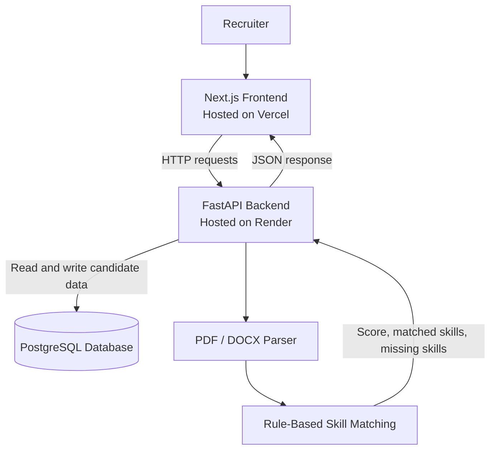
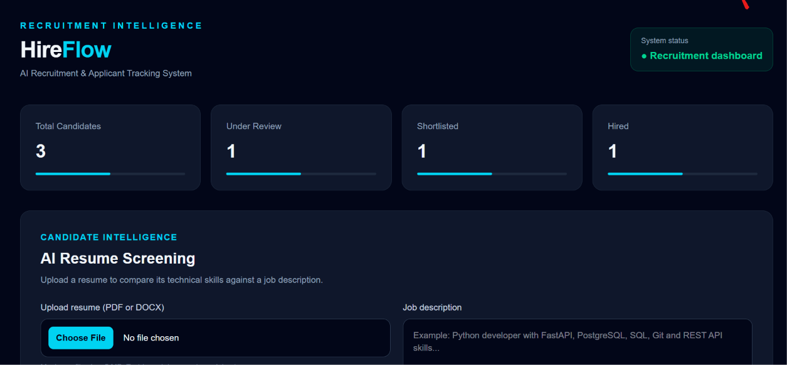
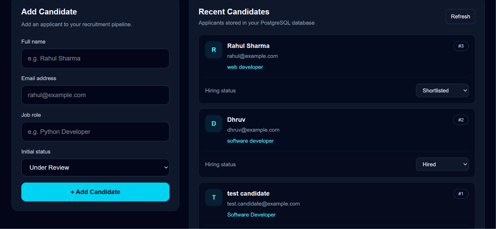
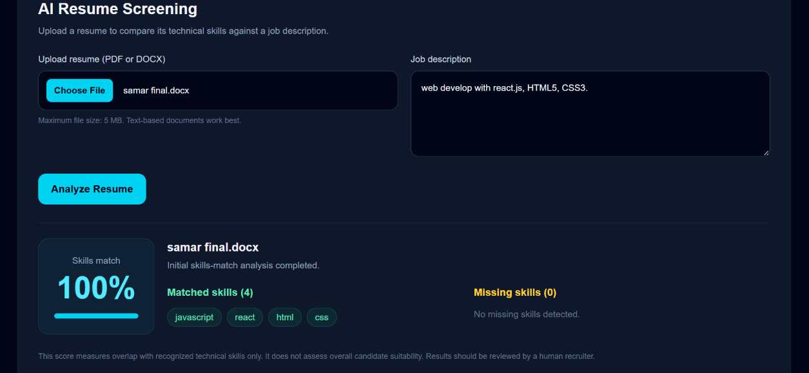

# HireFlow — AI Recruitment & Applicant Tracking System

HireFlow is a web-based recruitment and Applicant Tracking System (ATS) designed to help recruiters manage candidates and perform initial resume-to-job-description skill matching.

**Live Demo:** https://hireflow-frontend-lime.vercel.app/

**Backend API:** https://hireflow-backend-2.onrender.com

**API Documentation:** https://hireflow-backend-2.onrender.com/docs

**Frontend Repository:** https://github.com/DhruvThakur0325/hireflow-frontend

**Backend Repository:** https://github.com/DhruvThakur0325/hireflow-backend

## Features

- **Candidate Management:** Add and view candidate records.
- **Candidate Status Tracking:** Track candidates through Under Review, Shortlisted, Rejected, and Hired statuses.
- **Resume Screening:** Upload PDF or DOCX resumes for initial skill matching against a job description.
- **Match Score:** Calculate a percentage based on recognized required skills found in the resume.
- **Matched and Missing Skills:** View which recognized skills appear in the resume and which are missing.
- **Persistent Storage:** Store candidate records in PostgreSQL.
- **REST API:** Use FastAPI endpoints to manage candidates and screen resumes.
- **Responsive Web Interface:** Access the deployed application through a browser.

## Technology Stack

| Layer | Technologies |
|---|---|
| Frontend | Next.js, React, TypeScript |
| Backend | Python, FastAPI |
| Database | PostgreSQL |
| ORM | SQLAlchemy |
| Data validation | Pydantic |
| Resume parsing | pypdf, python-docx |
| Frontend hosting | Vercel |
| Backend hosting | Render |
| Version control | Git, GitHub |

## Architecture



## Resume Screening Workflow

1. A recruiter uploads a PDF or DOCX resume.
2. The recruiter provides a job description.
3. The backend extracts readable text from the resume.
4. The skill matcher identifies supported technical skills in the job description and resume.
5. The system calculates the percentage of required skills matched.
6. The API returns the filename, score, matched skills, and missing skills.

**Important:** The current screening engine uses rule-based keyword matching. Its score measures overlap between recognized skills, not a candidate's overall ability or suitability. It does not replace human review.

## API Endpoints

| Method | Endpoint | Purpose |
|---|---|---|
| GET | `/` | Check the API welcome response |
| GET | `/health` | Check API health |
| POST | `/candidates` | Create a candidate |
| GET | `/candidates` | Retrieve candidates |
| GET | `/candidates/{candidate_id}` | Retrieve one candidate |
| PATCH | `/candidates/{candidate_id}/status` | Update candidate status |
| POST | `/screen-resume` | Screen a resume against a job description |

Interactive API documentation is available at:

https://hireflow-backend-2.onrender.com/docs

## Run Locally

### Prerequisites

- Node.js and npm
- Python
- PostgreSQL or a configured PostgreSQL database
- Git

### 1. Clone the repositories

```bash
git clone https://github.com/DhruvThakur0325/hireflow-frontend.git
git clone https://github.com/DhruvThakur0325/hireflow-backend.git
```

### 2. Start the backend

Open a terminal in the backend directory.

```bash
python -m venv .venv
```

Activate the virtual environment on Windows:

```powershell
.\.venv\Scripts\Activate.ps1
```

Install dependencies:

```bash
python -m pip install -r requirements.txt
```

Configure the database connection using the environment variables expected by the backend's database configuration. Do not commit credentials or secrets.

Start the API:

```bash
python -m uvicorn main:app --reload
```

Backend: http://127.0.0.1:8000

API documentation: http://127.0.0.1:8000/docs

### 3. Start the frontend

Open another terminal in the frontend directory.

```bash
npm install
```

Create a `.env.local` file in the frontend project root:

```env
NEXT_PUBLIC_API_URL=http://127.0.0.1:8000
```

Start the development server:

```bash
npm run dev
```

Frontend: http://localhost:3000

For local development, ensure the backend CORS configuration allows the local frontend origin.

## Screenshots

Add screenshots of the actual deployed application in the `docs/screenshots/` directory.

Suggested screenshots:

- `dashboard.png` — Main HireFlow dashboard
- `candidates.png` — Candidate management page
- `resume-screening.png` — Resume screening results

Once screenshots have been added, display them here:

```markdown
## Application Screenshots

### Dashboard


### Candidate Management


### Resume Screening

```

## Security and Limitations

- Never commit database passwords, API keys, or production secrets.
- Resume uploads are currently limited to PDF and DOCX files, with a 5 MB size limit.
- Scanned documents may require OCR, which is not currently included.
- Skill matching depends on the configured skill vocabulary and text extraction quality.
- The match score is an initial keyword-based indicator, not an objective assessment of a candidate.
- Review uploaded resume data carefully and avoid using automated scores as the sole basis for hiring decisions.

## Future Improvements

- More advanced resume parsing and configurable skill aliases
- Job description management
- Recruiter authentication and role-based access
- Advanced hiring analytics and dashboards
- Automated testing and improved error handling
- More detailed candidate-to-job matching

## Author

**Dhruv Thakur**

BCA Student | Aspiring Full-Stack Developer

- GitHub: https://github.com/DhruvThakur0325
- LinkedIn: https://linkedin.com/in/dhruvthakur0325/

---

Built as a full-stack learning project to explore web development, API design, database integration, and resume screening.